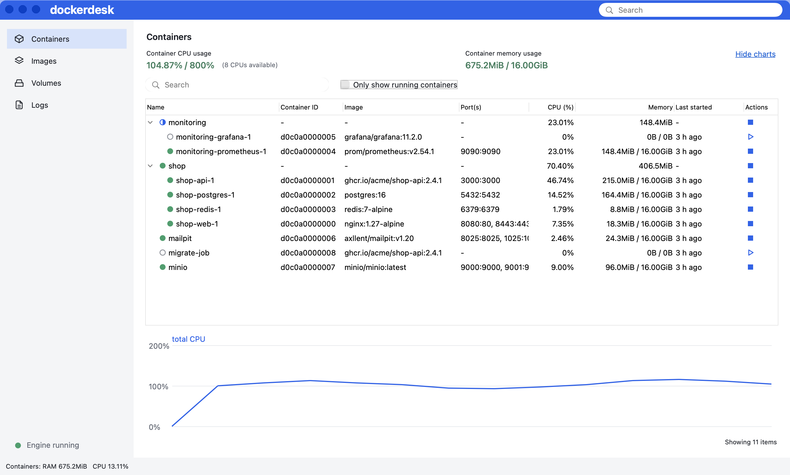
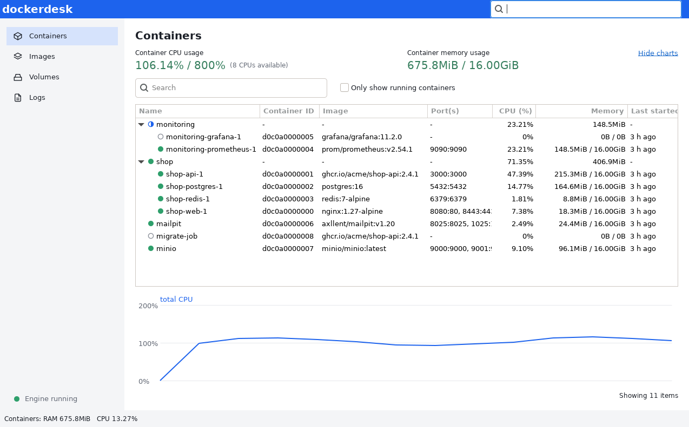
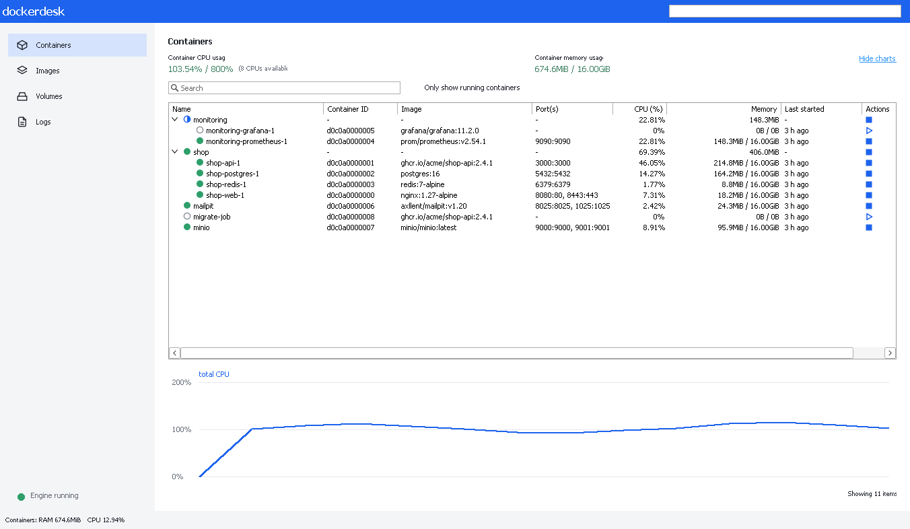

# dockerdesk

A small Docker Desktop look-alike written on the [gowt](https://github.com/haiodo/gowt) facade
(pure-Go native GUI, no cgo; Cocoa on macOS, GTK 3 on Linux, Win32 on Windows). It shows what gowt can do
and gives a baseline for comparing the memory use of a gowt UI with Docker Desktop's.

## Screenshots

| macOS light | macOS dark |
|---|---|
|  |  |

| Linux | Windows |
|---|---|
|  |  |

Regenerate with `make shots` (see below).

## Features

- Containers and compose projects (label `com.docker.compose.project`) as an expandable tree with
  CPU %, memory, ports, last started; search and "Only show running"; refresh every 2 s off the UI thread.
- Start, stop and restart for the selected container or group (only its visible members, after the
  search and running filters), from the row icons, the kebab or the context menu.
- Live CPU chart (last 60 samples) of the total and the selected container, drawn with the facade `Canvas`/`GC`.
- Log viewer: follow mode, tail 100/500/1000, stdout/stderr demultiplexed by the SDK.
- Images and Volumes lists (read-only).
- Docker-Desktop-like layout: blue header with search, grey sidebar, stat blocks, tree with status and
  action icons, footer. Light and dark palettes follow the system theme.

## Safety

- The only changing calls are start, stop and restart. Nothing is created, removed or pruned.
- Stop, restart and any group action ask for confirmation first; failures show in a dialog.
- Container environment variables are never read into the UI.

## Requirements

All platforms: Go 1.27 to build, and access to a running Docker Engine.

| OS | Needed to run |
|---|---|
| macOS | 13 (Ventura) or later |
| Linux | GTK 3 (`libgtk-3.so.0`; Debian/Ubuntu `libgtk-3-0`, Fedora `gtk3`, Arch `gtk3`, Alpine `gtk+3.0`) and an X11 or XWayland display |
| Windows | Windows 10 or later; gowt has only been run under Wine so far, not on real Windows |

No cgo and no C toolchain: the OS libraries are loaded at run time, so any host can cross-compile.

Engine address: `DOCKER_HOST`, else `/var/run/docker.sock`, else `~/.docker/run/docker.sock`
(Docker Desktop). The Docker SDK (`github.com/moby/moby/client`) negotiates the API version.

## Build and run

    make run          # go run .
    make build        # bin/dockerdesk for the host
    make cross        # bin/dockerdesk-{darwin-arm64,darwin-amd64,linux-amd64,windows-amd64.exe}
    make vet test     # vet and unit tests, no engine needed
    make shots        # window screenshots into docs/img/, needs a daemon with containers; opens a window
    make clean

    go run . -mem     # also log Go heap statistics to stderr every 10 s
    DOCKERDESK_LIVE=1 go test -run Live -v .   # read-only calls against the real engine

`make shots` writes `docs/img/dockerdesk-macos-light.png` and `-macos-dark.png` on macOS (it switches the
system appearance and restores it) and `docs/img/dockerdesk-<os>.png` on Linux and Windows; run it on each OS.

## Memory comparison

To be filled in: RSS of `dockerdesk` (measured from outside, e.g. `ps -o rss= -p <pid>`) next to the
Docker Desktop UI processes, same containers, same window size.
